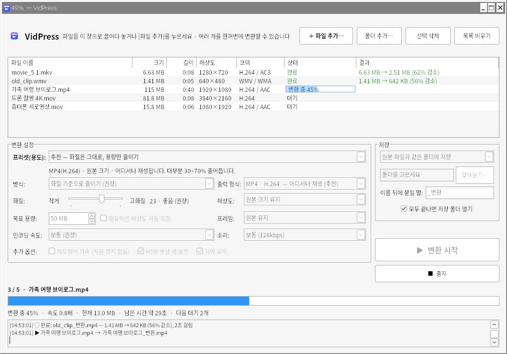
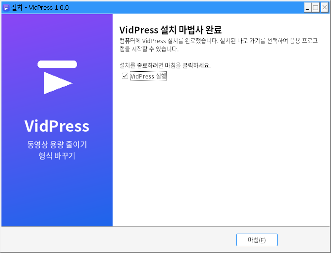

<p align="center">
  
</p>

<h1 align="center">VidPress</h1>

<p align="center">
  동영상 용량 줄이기 · 형식 바꾸기<br>
  HandBrake처럼 쓰는, 단순하고 가벼운 Windows 동영상 변환기
</p>



## 주요 기능

- **끌어다 놓기**로 여러 파일을 한꺼번에 변환 (폴더째 추가하면 하위 폴더까지 찾아 줌)
- **용도별 프리셋 8가지**
  - 추천(H.264), 더 작게(H.265), 최대 압축(720p), 메신저·카톡 전송용, 고화질 보관용
  - 목표 용량 맞추기 (예: 파일당 50MB 이하)
  - 형식만 바꾸기 (재압축 없음 · 화질 손실 없음 · 몇 초)
  - 소리만 추출 (MP3)
- **출력 형식**: MP4(H.264 · H.265 · AV1), MKV, WebM(VP9), MOV, AVI, TS / MP3, M4A, WAV, FLAC
- 해상도·화질·프레임·소리 조절 (원본보다 커지거나 늘어나지 않게 자동 처리)
- NVIDIA · Intel · AMD **하드웨어 가속** 자동 감지 (실패하면 CPU로 자동 재시도)
- 세로 영상과 회전 정보, 인터레이스, 아이폰 HDR 색 보정을 알아서 처리
- 진행률 · 남은 시간 · 작업 표시줄 진행 표시, 언제든 중지 가능
- 원본 파일은 절대 바꾸지 않음 (같은 이름이 있으면 `(2)`, `(3)`… 을 붙여 저장)
- 인터넷 연결 없이 내 컴퓨터 안에서만 동작

## 설치

1. [Releases](../../releases)에서 `VidPress-Setup-x.y.z.exe`를 받아 실행합니다.
2. 관리자 권한 없이 설치됩니다 (`%LOCALAPPDATA%\Programs\VidPress`).
   모든 사용자용으로 설치하려면 `VidPress-Setup-x.y.z.exe /ALLUSERS`로 실행하세요.
3. "Windows의 PC 보호" 창이 뜨면 **[추가 정보] → [실행]** 을 누르세요 (전자 서명이 없는 프로그램이라 나오는 경고입니다).

설치할 때 **'보내기' 메뉴에 추가**를 선택하면, 탐색기에서 동영상을 오른쪽 클릭 → **보내기 → VidPress** 로 바로 열 수 있습니다.
제거는 Windows **설정 → 앱 → 설치된 앱**에서 할 수 있습니다.

설치 없이 쓰려면 `VidPress-x.y.z-portable.zip`을 풀고 `VidPress.exe`를 실행하세요 (`ffmpeg` 폴더와 같은 곳에 있어야 합니다).



## 사용법

1. 동영상을 창으로 끌어다 놓거나 **[＋ 파일 추가…]** 를 누릅니다.
2. 프리셋을 고릅니다. 잘 모르겠으면 **추천** 그대로 두세요.
3. **[▶ 변환 시작]** 을 누릅니다. 결과는 기본적으로 원본 옆에 `이름_변환.mp4`로 저장됩니다.

자세한 설명은 [사용설명서](docs/사용설명서.txt)를 보세요.

## 직접 빌드하기

필요한 것:

- [Go](https://go.dev/dl/) 1.24 이상
- (설치 파일을 만들 때) [Inno Setup](https://jrsoftware.org/isdl.php) 6.7 이상

```bat
build.bat            :: 버전 1.0.0으로 빌드
build.bat 1.2.0      :: 버전을 지정해서 빌드
```

`build.bat`는 다음을 차례로 합니다.

1. `dist\VidPress\VidPress.exe` 빌드
2. FFmpeg가 없으면 [BtbN/FFmpeg-Builds](https://github.com/BtbN/FFmpeg-Builds)에서 내려받아 `dist\VidPress\ffmpeg`에 넣기
3. Inno Setup이 있으면 `dist\VidPress-Setup-<버전>.exe` 만들기

Linux/macOS에서는 `./build.sh`로 exe만 크로스 컴파일할 수 있습니다.

### 테스트

변환 엔진(`engine/`)은 실제 FFmpeg로 동영상을 만들어 30가지 이상의 변환을 확인하는 테스트가 있습니다. PATH에 `ffmpeg`, `ffprobe`가 있어야 합니다.

```sh
go test ./engine/
```

## 릴리스 만들기

GitHub Actions 워크플로(`.github/workflows/build.yml`)가 들어 있으면 푸시할 때마다 테스트와 빌드 확인이 자동으로 실행되고,
`v`로 시작하는 태그를 올리면 설치 파일과 포터블 zip이 만들어져 Releases에 자동으로 올라갑니다.

```sh
git tag v1.0.0
git push origin v1.0.0
```

직접 올릴 때는 GitHub 저장소의 **Releases → Draft a new release**에서 `dist\VidPress-Setup-x.y.z.exe`를 첨부하면 됩니다.

## 프로젝트 구조

| 경로 | 내용 |
|---|---|
| `main.go` | 프로그램 시작, 명령줄 옵션, 작업 기록 |
| `ui.go` | 창 배치, 설정 화면, 파일 목록 |
| `batch.go` | 변환 시작 · 중지, 여러 파일 순서대로 변환, 진행률 |
| `queue.go` | 파일 목록(표) 데이터 |
| `config.go` | 설정 저장 (`%APPDATA%\VidPress\settings.json`) |
| `winutil_windows.go` | 폴더 선택 창, 탐색기 열기, 절전 방지 등 Windows 기능 |
| `engine/` | 변환 엔진: 동영상 정보 읽기, FFmpeg 명령 만들기, 진행률, 목표 용량 계산, 하드웨어 가속 감지 |
| `installer/` | 설치 프로그램 스크립트(Inno Setup)와 설치 화면 이미지 |
| `tools/mkres/` | exe 아이콘 · 버전 정보(`rsrc_windows_amd64.syso`)를 만드는 도구 |
| `assets/` | 아이콘 |
| `scripts/` | FFmpeg 내려받기 스크립트 |
| `docs/` | 사용설명서, 스크린샷 |

화면은 [walk](https://github.com/tailscale/walk)(Windows 기본 컨트롤)로 만들었고, 실제 변환은 FFmpeg가 합니다.

### 명령줄 옵션

```text
VidPress.exe [옵션] [파일/폴더 ...]
  --preset=N        N번째 프리셋으로 시작 (0=추천 … 7=소리만 추출)
  --outdir=폴더     결과를 이 폴더에 저장
  --autostart       파일 정보를 읽는 대로 바로 변환 시작
  --exit-when-done  모두 끝나면 프로그램 종료
```

## 라이선스

VidPress는 [MIT 라이선스](LICENSE)입니다.
설치 파일과 포터블 zip에는 GPL v3인 FFmpeg가 함께 들어 있습니다 (VidPress는 FFmpeg를 별도 프로그램으로 실행합니다).
자세한 내용은 [THIRD_PARTY_NOTICES.md](THIRD_PARTY_NOTICES.md)를 보세요.
